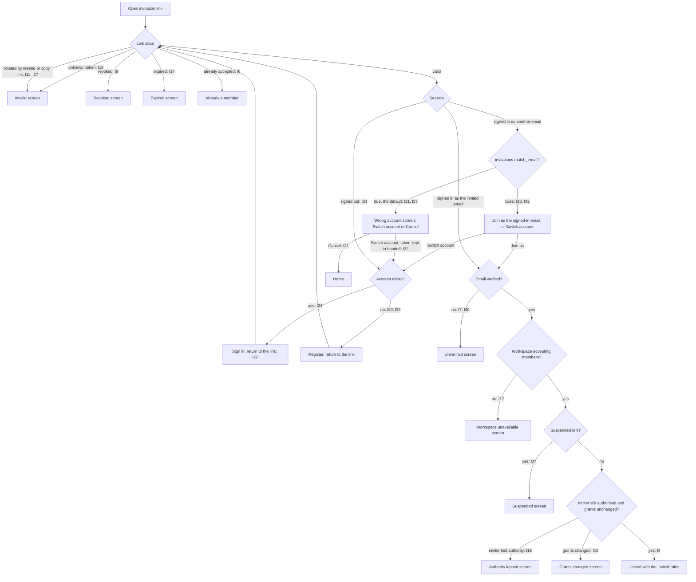
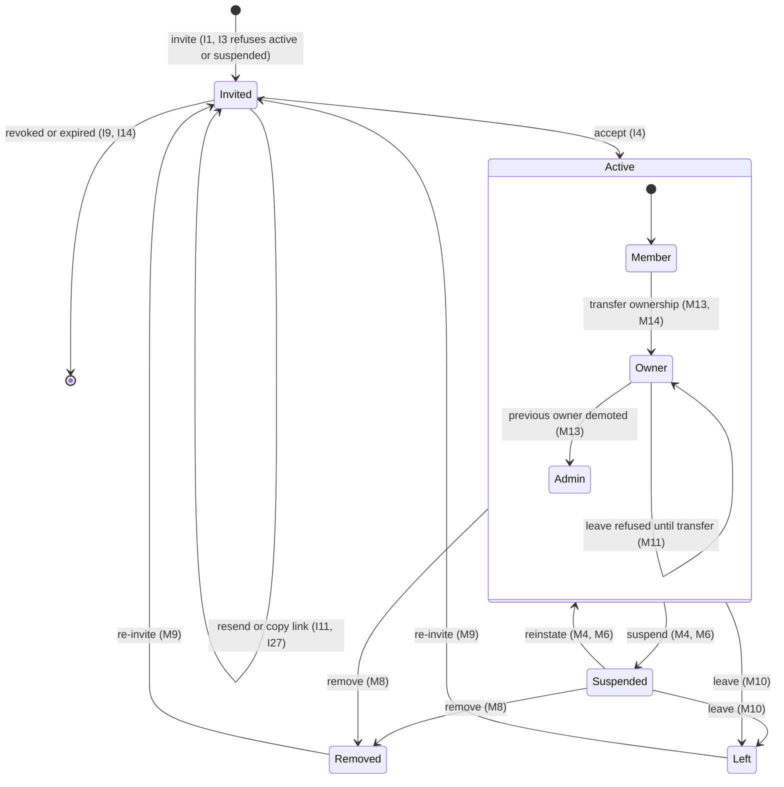
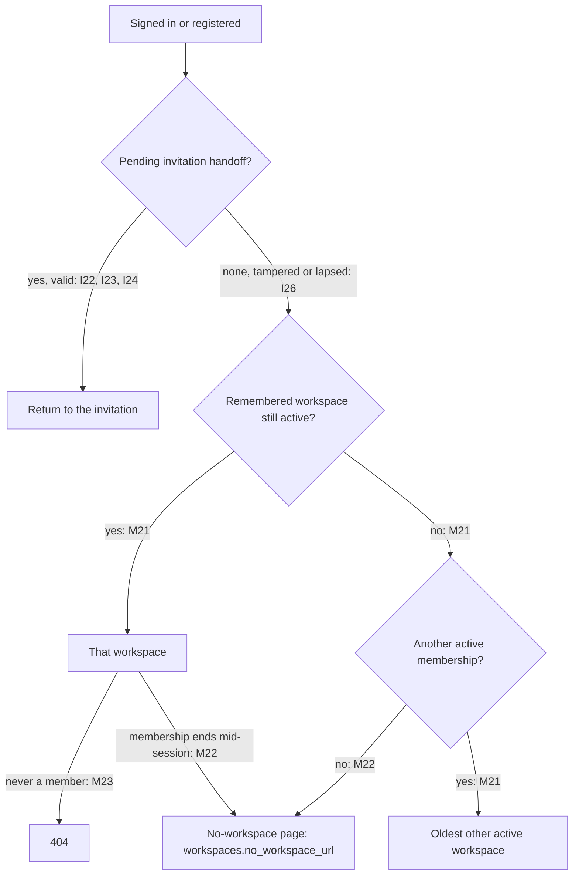

# Membership and invitation scenarios

Each row is one scenario, the behaviour concierge promises, and the test that proves it (`file::test`). Rows marked **planned** are not built yet. Workspace mode runs with Spatie teams on; app-wide mode (`tests/AppMode`) runs with teams off.

## Invitations

| ID | Scenario | Desired behaviour | Test |
| --- | --- | --- | --- |
| I1 | Invite an email | One pending invitation per email and workspace; only a token hash is stored | `tests/Feature/InvitationLifecycleTest.php::stores only a hash of the token and scopes invitations to the workspace` |
| I2 | Invite app-wide | No workspace; one pending invitation per email | `tests/AppMode/InvitationTest.php::issues invitations with no workspace and one pending per email` |
| I3 | Invite an active or suspended member | Refused; a suspended member is reinstated instead | `tests/Feature/InvitationLifecycleTest.php::refuses to invite active or suspended members` |
| I4 | Accept with the right account | Joins with exactly the invited roles | `tests/Feature/InvitationLifecycleTest.php::lets an existing account accept the exact invitation with its roles` |
| I5 | Accept app-wide | Roles go to the account; idempotent | `tests/AppMode/InvitationTest.php::grants the roles to the account on acceptance and is idempotent` |
| I6 | Accept twice | Idempotent for the accepting user | `tests/Feature/InvitationLifecycleTest.php::is idempotent for retries by the accepting user` |
| I7 | Accept with the wrong or an unverified account | Refused; nothing written | `tests/Feature/InvitationLifecycleTest.php::rejects the wrong account and unverified accounts without writing anything` |
| I8 | Decline | There is no decline action: an unaccepted invitation expires or is revoked | `tests/Feature/InvitationLifecycleTest.php::rejects expired invitations without persisting the expiry` |
| I9 | Revoke | The link dies at once | `tests/Feature/InvitationLifecycleTest.php::kills revoked and rotated links` |
| I10 | Revoke app-wide | Idempotent; frees the pending email | `tests/AppMode/InvitationTest.php::revokes an app-wide invitation idempotently and frees its pending email` |
| I11 | Resend | New token and expiry; the old link dies | `tests/Feature/InvitationLifecycleTest.php::kills revoked and rotated links` |
| I12 | Resend cooldown | A second resend within the cooldown is refused | `tests/Feature/InvitationLifecycleTest.php::enforces a resend cooldown` |
| I13 | Resend app-wide | Re-captures grants under the current manager | `tests/AppMode/InvitationTest.php::resends under the current manager with a new token, expiry and grant snapshot` |
| I14 | Expiry | Expired links are refused; reissuing lazily expires the old one | `tests/Feature/InvitationLifecycleTest.php::lazily expires a stale pending invitation when reissuing` |
| I15 | Inviter lost authority | Acceptance refused | `tests/Feature/InvitationLifecycleTest.php::revalidates inviter authority at acceptance` |
| I16 | Grants changed since issue | Acceptance refused | `tests/Feature/InvitationLifecycleTest.php::rejects grants whose roles gained permissions or were recreated after issuance` |
| I17 | Workspace not accepting members | Acceptance refused | `tests/Feature/InvitationLifecycleTest.php::rejects acceptance when the workspace no longer accepts members` |
| I18 | Unknown token | Refused | `tests/Feature/InvitationLifecycleTest.php::rejects unknown tokens` |
| I19 | Delivery | Queued, encrypted, only with a host URL; stale deliveries dropped | `tests/Feature/DeliveryAndInspectionTest.php::drops stale deliveries after rotation or revocation` |
| I20 | Register through an invitation | The register link remembers the token | `tests/Fortify/RememberedInvitationTest.php::remembers the token from the register link and registers through the unchanged form` |
| I21 | Switch account: signed in as another email | The page says who the invitation is for and who is signed in, with Switch account and Cancel | `tests/Browser/accept.spec.ts::names both accounts and switches with POST, or cancels` |
| I22 | Switch account: sign in after switching | Sign-out keeps an encrypted, short-lived handoff; sign-in returns to the invitation once | `tests/Fortify/SwitchAccountTest.php::signs the wrong account out and keeps the invitation through sign-in` |
| I23 | Switch account: register after switching | Registration returns to the invitation; the handoff counts as the register link | `tests/Fortify/SwitchAccountTest.php::returns to the invitation after registering, and the handoff counts as the register link` |
| I24 | Signed out with an existing account | Sign in, then return to the invitation | `tests/Fortify/SwitchAccountTest.php::returns a signed-out user with an account to the invitation after sign-in` |
| I25 | Switch account: expired or revoked after the switch | The returned page shows expired or revoked | `tests/Fortify/SwitchAccountTest.php::shows an invitation revoked or expired after the switch as such` |
| I26 | Switch account: tampered, forged, off-site or lapsed handoff | Ignored; sign-in goes home | `tests/Fortify/SwitchAccountTest.php::ignores a tampered, forged or stale handoff` |
| I27 | Copy link | Rotates the token without email; the old link dies; inviters only | `tests/Feature/InvitationLinkAndMessageTest.php::copies a link by rotating the token: the old link dies and nothing is emailed` |
| I28 | Copy link row action | Offered to inviters on pending invitations, with a confirm | `tests/Feature/InvitationLinkAndMessageTest.php::offers copy link on pending invitations to inviters only, warning that the previous link stops working` |
| I29 | Invitation message | An optional message of up to 500 characters on invite and resend, shown on rows and passed to delivery | `tests/Feature/InvitationLinkAndMessageTest.php::keeps an optional message on invite and resend, on the rows and in delivery` |
| I30 | Change roles of a pending invitation | Without revoke and reissue | planned (part B) |
| I31 | Invite rate limiters | Named limiters for invite, inspect and accept | planned (part B) |
| I32 | Bulk invite | Skips emails with a pending invitation | planned (part B) |
| I33 | Prune expired invitations | A command deletes old expired invitations | planned (part B) |
| I34 | Email +alias policy | Opt-in alias folding; distinct by default | planned (part B) |
| I35 | SSO or social accept | Requires a verified provider email | planned (part B) |
| I36 | Mixed-case email | Matches end to end | planned (part B) |
| I37 | Signed in as another email, `invitations.match_email` true (default) | Refused as the wrong account | `tests/Feature/JoinAsCurrentAccountTest.php::refuses another account by default` |
| I38 | Join as the signed-in account, `match_email` false | A verified other email joins; the invitation records `accepted_by_id` and `accepted_with_other_email` | `tests/Feature/JoinAsCurrentAccountTest.php::lets a verified other account join when match_email is false and records it` |
| I39 | Join as the signed-in account app-wide | The same, with teams off | `tests/AppMode/JoinAsCurrentAccountTest.php::grants a verified other account when match_email is false and records it` |
| I40 | Join as: unverified, revoked or expired | Refused; every other check is unchanged | `tests/Feature/JoinAsCurrentAccountTest.php::still refuses an unverified other account and every other check` |
| I41 | Join as: already a member | The invitation is consumed without grants | `tests/Feature/JoinAsCurrentAccountTest.php::consumes the invitation for an other account that is already a member` |
| I42 | Join as on the page | "Join as {current email}" beside Switch account, with "This invitation was sent to {email}" | `tests/Browser/accept.spec.ts::offers to join as the signed-in account when the email may differ` |
| I43 | Accepted by another email on the members index | The member row has `acceptedWithOtherEmail` and `invitedEmail` | `tests/Feature/JoinAsCurrentAccountTest.php::shows who accepted with another email on the member row` |

## Membership

| ID | Scenario | Desired behaviour | Test |
| --- | --- | --- | --- |
| M1 | Rank rules | Admins grant presenter, never admin or owner | `tests/Feature/MembershipManagementTest.php::lets admins grant presenter but never admin or owner` |
| M2 | Rank rules app-wide | The same, with teams off | `tests/AppMode/OwnershipTest.php::lets admins grant presenter but never admin or owner` |
| M3 | Protect owner, equals and self | Refused | `tests/Feature/MembershipManagementTest.php::protects the owner, equal ranks and the actor themselves` |
| M4 | Suspend and reinstate | Roles are kept | `tests/Feature/MembershipManagementTest.php::suspends and reinstates without losing roles` |
| M5 | Suspend and reinstate row actions | Offered by rank, with a suspended status for the badge | `tests/Feature/MembersIndexTest.php::swaps suspend for reinstate, shows removed members only when asked, and confirms the destructive actions` |
| M6 | Suspend and reinstate confirms | Each asks first | `tests/Feature/InvitationLinkAndMessageTest.php::confirms suspend and reinstate` |
| M7 | Suspension blocks invitations | A suspended member cannot accept their way back | `tests/Feature/InvitationLifecycleTest.php::never lets an invitation bypass a suspension` |
| M8 | Remove | Ends one workspace only | `tests/Feature/MembershipManagementTest.php::removes membership in one workspace only` |
| M9 | Rejoin after removal | Through a fresh invitation | `tests/Feature/InvitationLifecycleTest.php::lets a removed member rejoin through a fresh invitation` |
| M10 | Leave | The member removes themselves | `tests/Feature/LeaveWorkspaceTest.php::lets a member leave: removed by themselves, roles and permissions gone, the user and other workspaces untouched` |
| M11 | Owner leaves | Refused until ownership is transferred | `tests/Feature/LeaveWorkspaceTest.php::refuses the owner: ownership is transferred first, and then they can leave` |
| M12 | Leave app-wide | Refused: a workspace action | `tests/AppMode/LeaveWorkspaceTest.php::is a workspace action: app-wide mode, with no workspaces and Spatie teams off, refuses it` |
| M13 | Transfer ownership | The old owner is demoted | `tests/Feature/OwnershipTest.php::transfers ownership and demotes the previous owner` |
| M14 | Transfer needs recent authentication | Refused without it | `tests/Feature/OwnershipTest.php::requires recent authentication` |
| M15 | Search members and invitations | Case-insensitive on every database (ilike on PostgreSQL); `%` and `_` are literal | `tests/Feature/MembersIndexTest.php::searches members and invitations without regard to case, on every database` |
| M16 | Tenant isolation | Managers of one workspace cannot touch another | `tests/Feature/MembershipManagementTest.php::isolates tenants: managers of one workspace cannot touch another` |
| M17 | Last owner app-wide | Cannot be removed or demoted | `tests/AppMode/OwnershipTest.php::protects the last owner from removal and demotion` |
| M18 | Deactivate and restore | Sessions end; roles are kept | `tests/AppMode/DeactivationTest.php::restores a user with their roles and clears the deactivation record` |
| M19 | Deactivate in workspace mode | Memberships and roles untouched | `tests/Feature/UserDeactivationTest.php::deactivates and restores a user in workspace mode, leaving memberships and roles alone` |
| M20 | User deletion app-wide | Last-owner guard; soft delete keeps the account row | `tests/AppMode/DeletionTest.php::lets an owner with a co-owner delete their account, and refuses the last owner` |
| M21 | Workspace unavailable after remove, leave or suspend | The current workspace is repointed to another active membership, or none | `tests/Feature/WorkspaceContextTest.php::repoints the current workspace after remove, leave or suspend` |
| M22 | Request for an unavailable workspace | Redirect to the no-workspace route; JSON gets a 403 | `tests/Feature/WorkspaceContextTest.php::fails closed in middleware: 404 without context or a membership, the no-workspace route once it is unavailable` |
| M23 | A workspace that never existed for the user | 404 | `tests/Feature/WorkspaceContextTest.php::fails closed in middleware: 404 without context or a membership, the no-workspace route once it is unavailable` |
| M24 | User deletion in workspace mode | Last-owner guard, membership cleanup, soft delete and restore | planned (part B) |
| M25 | Re-invite a deactivated user in workspace mode | Covered end to end | planned (part B) |
| M26 | Pending invitations when a workspace becomes unavailable | Covered end to end | planned (part B) |

## Diagrams

Every branch is labelled with the scenario row it stands for.

### Accepting an invitation

With `match_email` false, an accepting user whose email differs is recorded on the invitation (`accepted_with_other_email`, I38) and shown on the member row (I43).

A handoff that is tampered with, forged or lapsed is ignored, and sign-in goes home (I26). An invitation that expires or is revoked during the switch shows its own screen on return (I25).

### Membership lifecycle

The owner can't be removed, demoted or deactivated by an equal or lower rank (M3). In app-wide mode the last owner can't be removed, demoted or deleted (M17, M20).

### Landing after sign-in

What the no-workspace page offers, such as creating a workspace or provisioning through a tenant invitation, is up to the host. Concierge only sends the user there.
